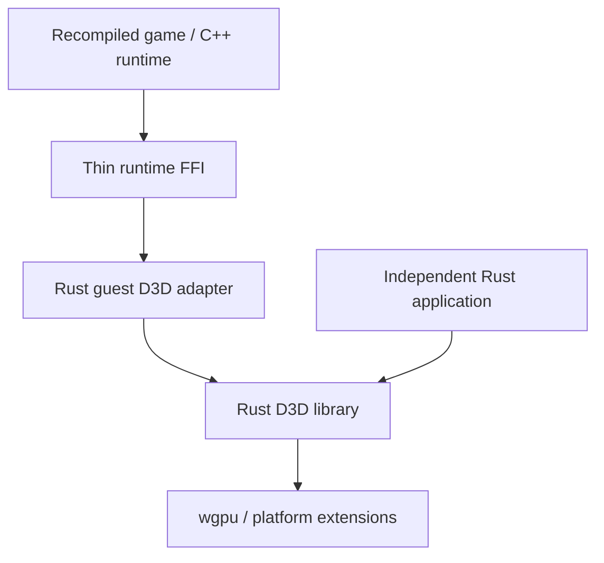

# Rustify and modularity preplan

Working notes for a later plan, not a commitment to migrate every component or
change behavior. The aim is to make useful pieces independently usable, with
explicit ownership and narrow integration boundaries. Moving code to Rust is a
means to that end; it does not establish a boundary by itself. Each migration
stage should leave recomp-kit working.

## D3D7/8/9: initial proposal

Move the implemented D3D7/8/9 behavior into an independently usable Rust
library, with a separate guest adapter for recomp-kit:

The boundary between guest integration and Direct3D behavior is the central
one. Include currently implemented D3D7/8/9 and associated D3DX support; make
D3D7's interaction with DirectDraw explicit. Full DirectDraw or D3D11
migration, expanded shader support, and a Windows replacement DLL are separate
projects.

### Proposed stages

1. **Ownership and public API.** Inventory devices, resources, bindings,
   surface views, locks and presentation; assign each responsibility one
   owner. Expose ordinary Rust descriptors, handles, borrowed data and
   structured results, independent of CXX, guest addresses and generic kit COM
   objects. Stop when the existing C++ bridge can call a usable Rust API.
2. **D3D behavior and resource ownership.** Move remaining validation,
   descriptors, resource relationships and state bookkeeping from C++ in
   coherent groups: device creation/reset, resource creation, locks, bindings,
   draws and presentation. D3D8 likely needs more work; D3D9 is a useful
   starting point. Preserve failure behavior and ordering. Stop when C++
   mostly decodes arguments, accesses guest memory, manages guest interfaces
   and calls Rust.
3. **Guest adapter.** Move D3D-specific guest interface records, marshaling,
   HRESULT conversion and lock staging into a separate Rust adapter. Supply a
   small runtime interface for guest memory, allocation, interface registration
   and host services. Decide which shared COM services remain shared and which
   records become Rust-owned. Preserve explicit 32-bit guest addresses, guest
   and internal references, and weak-cache semantics. Stop when C++ mainly
   registers and forwards runtime calls.
4. **Embedding and presentation.** Accept a caller-supplied GPU context or
   configurable adapter creation. Specify offscreen output, surface presentation
   and optional native texture sharing, including ownership and synchronization.
   Move suitable process-wide configuration to device options and review the
   single-D3D9-device restriction. Stop when an external application can create
   a renderer and present without kit infrastructure.
5. **Packaging and qualification.** Make CXX optional or replace the reduced
   boundary with a small C ABI. Feature-gate windowing, probes and optional
   D3DX; retain external shader compilation behind an explicit native interface.
   Complete package metadata, licensing, build integration and a precise support
   matrix. Qualify Vulkan and DX12 separately from existing Metal evidence. Stop
   when recomp-kit consumes the same library available to another project.

Stages 1–2 are the first milestone. Pay particular attention to destruction
order, COM identity, reset failure paths, guest lock memory and asynchronous
frame ownership. Treat discovered behavior changes separately and check them
against original evidence. Verification should use existing checks and rebuild
the windowed app, followed by user app review; executing the app or GPU probes
requires user approval.

### Current seams and questions

- [Architecture](docs/architecture.md) records the current split: C++ owns
  guest COM identity and staging, while Rust owns substantial D3D state and
  resources. D3D9 reset is a staged transaction; its holder pools, loss token,
  implicit targets and weak COM caches must be considered together.
- [Renderer crate](graphics/d3d8-wgpu/src/lib.rs) exposes `backend`, `bridge`,
  `d3d8`, `d3d9` and `probe`. Its [README](graphics/d3d8-wgpu/README.md)
  describes Rust ownership and the CXX boundary; `bridge.rs` also contains
  device/resource ownership and D3D7 state. Audit which public types and
  operations currently depend on bridge types before promising a standalone API.
  The README calls the interface a host-only C ABI and also a CXX bridge;
  clarify the actual exported boundary during the inventory.
- [Cargo manifest](graphics/d3d8-wgpu/Cargo.toml) currently builds both a
  static library and Rust library, unconditionally depends on CXX and winit,
  and includes probe binaries. Its package is unpublished and describes a
  D3D8 prototype despite covering more. Feature and package separation needs a
  dependency and build-script audit, not just manifest changes.
- [D3D bridge helpers](dx/d3d_bridge_helpers.h), [D3D7](dx/d3d7.cpp),
  [D3D8](dx/d3d8.cpp), [D3D9](dx/d3d9.cpp), [DirectDraw](dx/ddraw.cpp)
  and [COM infrastructure](dx/com.cpp) are starting points for the ownership
  inventory. Identify cross-API surface identity and lifetimes before moving
  the D3D7 adapter.
- [D3DX](dx/d3dx9.cpp) and [shader compilation](dx/d3dx9_compile.cpp)
  combine guest-facing interfaces with Rust-backed objects and a native
  compiler dependency. Specify the standalone compiler interface and optional
  features without assuming that all D3DX methods are implemented.
- The legacy [host GPU interface](host/gpu/gpu.h) and
  [presentation worker](host/present_thread.cpp) are distinct from the Rust
  renderer's wgpu backend. Trace both frame paths, texture handoff, fallback
  readback and completion before proposing a common presentation interface.
  The presenter must only consume sealed frames and retained resources.

## Wider repository inventory

These are investigation leads, not approved migrations. Existing boundaries
are useful evidence, not necessarily the desired final architecture.

| Area | Current shape | Questions for a later plan |
| --- | --- | --- |
| Translator | [Rust workspace](translator/Cargo.toml) already splits image, discovery, decoding, IR, analysis, SSA, planning, emission and output into crates; [guide](docs/translator.md) describes their roles. | Audit crate dependencies and public contracts for actual reuse. Keep generated C, runtime instruction semantics and p-code ABI compatible. Is independent image analysis or translation useful outside the kit? |
| Guest runtime | [runtime](runtime/README.md) contains memory, PE loading, dispatch, imports, cooperative scheduling, Win32 services and p-code fallback. [memory](runtime/memory.cpp), [imports](runtime/imports.cpp) and [kernel32](runtime/kernel32.cpp) are central seams. | Separate guest execution primitives from Win32 policy and host services only after mapping global state and initialization/teardown. Define who holds the scheduler baton and how 32-bit memory access and callbacks are enforced across FFI. |
| DirectX and other shims | [dx](dx/README.md) combines COM, graphics, input, audio and media adapters; [host_api.h](dx/host_api.h) defines host-facing services. | Inventory shared COM and host dependencies before splitting by subsystem. Keep unsupported operations named and observable; do not assume a D3D-specific COM design fits audio or input. |
| Host and presentation | [host](host/README.md) contains SDL lifecycle, input, composition, frame pacing and audio. The [GPU interface](host/gpu/gpu.h) has Metal, Vulkan, WebGPU and fake implementations. | Identify reusable frame, rendering and audio contracts versus application/window policy. Preserve sealed-frame lifetime, completion and audio synchronization; compare the existing GPU abstraction with wgpu rather than assuming they should merge. |
| Platform | [platform/os.h](platform/os.h) is the OS boundary; [CMake](platform/CMakeLists.txt) selects POSIX or Win32 implementations. | Audit portability, ownership and error contracts before introducing Rust wrappers. Keep OS-specific calls and conditionals within the existing platform boundary. |
| Mods | [mods](mods/CMakeLists.txt) includes a C API, Lua, hooks, settings and native replacements; [pop_mod_api.h](mods/pop_mod_api.h) is an external-facing contract. | Separate stable plugin ABI and lifecycle from implementation, and preserve teardown, callback and guest-memory rules. A Rust implementation must not silently change the C or Lua contracts. |
| Controls and launcher | [host/controls](host/controls) contains models, routing, mapping and UI; [host/launcher](host/launcher) contains launcher logic and SDL integration. [desktop/library](desktop/library/Cargo.toml) is a separate Tauri Rust application. | Identify existing UI-independent models and persistence formats as possible reusable units; avoid coupling a library to SDL or Tauri. Check whether sharing code across the two applications is worthwhile. |
| Build and tools | [tools/build.py](tools/build.py) orchestrates builds; [CMake](CMakeLists.txt) composes native targets and [dx/CMakeLists.txt](dx/CMakeLists.txt) builds and links the Rust renderer. | Map build-time and runtime dependencies, generated artifacts, cross-compilation and feature choices before extracting packages. Preserve the supported build entry point and game/build-root separation. |

The native build already has `recomp_platform`, `recomp_runtime`, `recomp_dx`,
`recomp_mods` and GPU targets, but several are CMake object libraries composed
into hosts rather than independently packaged interfaces. Target names alone do
not prove that their APIs or lifetimes are independent. Similarly, Rust's
translator crates and renderer modules are starting points for an API audit,
not evidence that every crate is ready for external consumers.

## Follow-up investigation

- Draw actual dependency and ownership maps, including initialization,
  shutdown, globals, callbacks, thread affinity and guest/host memory crossings.
- For each candidate, identify a real external consumer or a kit integration
  that benefits from the boundary, an incremental stopping point, and the
  compatibility and performance evidence needed to move it.
- Record dependencies and license obligations for any proposed package; do not
  infer supported platforms or API coverage from successful compilation alone.
- Preserve game independence: game addresses belong in configuration and
  generated hooks, while generated files and local game artifacts stay out of
  source control.
- Use existing checks appropriate to each change. Translator changes require
  translator cases first and the bounded diff-harness workflow in
  [AGENTS.md](AGENTS.md); no new tests are implied by this preplan.

## Deeper implementation notes

This pass is a source inventory, not a complete call-graph or an assertion that
any of these components can already be extracted. Paths below are starting
points for tracing actual callers, lifetimes and platform coverage.

### D3D and DirectDraw ownership details

- [com.h](dx/com.h) has a single `ComObj` record with fields for DirectDraw,
  surfaces, old D3D devices, DirectSound and other object kinds, as well as
  Rust-backed D3D holders. It tracks object IDs, guest interface views,
  external and internal references and a fixed first-view `IUnknown`
  identity. Its ref hooks, destructor hooks and QueryInterface hooks are part
  of the effective lifecycle contract. A D3D adapter cannot simply replace the
  record without accounting for callers that use these services and IDs.
- The same record shows why D3D7 and DirectDraw need a joint inventory:
  surfaces carry guest pixel addresses, optional ownership of those bytes,
  locks, palettes, clippers, flip and depth attachments, mip links and texture
  handles. A writable lock pointer may remain in use after the lock. A surface
  can also point at guest-owned bytes via `SetSurfaceDesc`. Determine which
  relationships belong in a shared surface service and which are D3D-specific;
  a copied lock buffer alone cannot express every current DirectDraw behavior.
- [D3D9 handlers](dx/d3d9.cpp) still perform guest structure reads and writes,
  window/display integration, COM identity and state-block reference
  management. They synchronize guest-locked buffers before draws, and support
  GDI refresh by reading the presented image back. The adapter design needs
  ordering and failure rules for each of these, not just a type conversion.
- Trace a representative create → bind → lock → draw → present → reset →
  release path for each API version. Record guest-visible results, identity,
  allocations, what is copied, and what remains live at each call. Include
  failure during partial creation and reset, a locked resource at reset, views
  of parent resources, bound but externally released objects, and teardown
  after the guest heap has been reset.
- [display_seam.h](runtime/display_seam.h) documents current presentation
  alternatives: synchronous ARGB/RGBA snapshots, a native texture handoff
  with ready event/value and a busy flag, and CPU fallback if the presenter
  cannot use the texture. Window placement, refresh pacing and GDI composition
  are also present. An external renderer contract must specify ownership,
  readiness, reuse and completion for each output; passing an opaque native
  handle alone is insufficient.
- The renderer's [backend](graphics/d3d8-wgpu/src/backend/mod.rs) owns wgpu
  machinery and caches; [render/compile.rs](graphics/d3d8-wgpu/src/render/compile.rs)
  runs a compiler worker. D3D9's shader path has admission, interpreter
  coverage and specialized pipeline compilation as separate decisions, with
  owned recipes and per-device caches described in the
  [renderer README](graphics/d3d8-wgpu/README.md). Preserve queue ordering,
  worker shutdown, cache identity and compilation failure reporting when
  separating code. Independent rendering should not require exposing these
  internal recipes as stable API.
- Some renderer settings are process-wide environment reads cached in
  `OnceLock`, including shader mode and diagnostic controls in
  [D3D9 draw selection](graphics/d3d8-wgpu/src/d3d9/draw/uber.rs) and D3D8
  options in [device.rs](graphics/d3d8-wgpu/src/d3d8/device.rs). Classify each
  as compatibility behavior, performance policy or diagnostics before moving
  it to options. Multiple devices may need different options; decide how old
  environment settings map to defaults at the kit boundary. Process-wide ID
  generators and caches also need an audit, but are not automatically bugs.

### Generated interfaces and renderer packaging

- [dx/CMakeLists.txt](dx/CMakeLists.txt) generates D3D8/D3D9 COM interfaces
  and constants from pinned Wine headers and binding/name lists. It also
  generates D3DX9 interface and import tables. The lists and generator inputs
  are source; the produced includes are disposable build output. A Rust guest
  adapter must retain interface slot order, signatures, unsupported-method
  diagnostics and reproducible generation, even if the generator output
  language changes.
- [build.rs](graphics/d3d8-wgpu/build.rs) generates and validates D3D9
  interpreter shader material, emits Metal source, fingerprints crate inputs,
  and builds the CXX bridge. Separating optional CXX and probes must not
  accidentally skip shader validation or invalidate the build fingerprint.
  Audit non-Rust shader inputs and rerun dependencies as well as native linking.
- The native build selects a game-local renderer override if present, otherwise
  the kit crate, and can consume staged dependencies. The direct Cargo path in
  `dx/CMakeLists.txt` rejects cross-compilation and non-native multi-architecture
  builds; staged dependencies are a separate route. Establish supported build
  paths per target before setting standalone portability goals. The renderer
  archive, generated CXX headers and native link flags are all part of the
  current integration, including for the null-host target.
- The manifest's `wgpu`, shader and image dependencies, platform-specific
  Metal dependencies, CXX and `winit` have different purposes. Inventory the
  actual call sites and dependency feature sets before drawing package lines;
  possible modules include core D3D semantics, GPU backend, D3DX, adapter,
  windowing and probes, but one crate with features may be preferable for
  some boundaries. Decide only after checking compile and distribution costs.
- Qualification should distinguish CPU-only model/resource checks, shader
  validation, GPU readback, windowed presentation, guest integration and
  original-implementation comparisons. Record backend, platform, device,
  revision, operation coverage and failure modes for each claim. The existing
  Metal evidence does not by itself establish D3D equivalence or Vulkan/DX12
  behavior.

### Runtime, execution and FFI

- [guest.h](runtime/guest.h) uses `x86.h` for CPU state, instruction helpers
  and guest memory access; its bounds check uses a 32-bit address and length,
  while `gm_ptr` resolves into the current arena. [memory.h](runtime/memory.h)
  exposes heap allocation and arena swapping. A Rust-facing memory interface
  should specify checked ranges, overflow, null handling, alignment and
  unaligned records; borrowed host slices must not outlive the access scope or span an arena
  content swap, guest mutation or callback that can invalidate their assumptions.
  `recomp_arena_swap` exchanges bytes with the arena; it does not swap `g_mem`
  pointers.
- [guest_call](runtime/guest.h) handles guest stack setup, dispatch and ESP
  restoration. A callback interface needs to state reentrancy, which guest
  thread owns the baton, whether the callback can yield, and error/unwind
  behavior. Avoid allowing Rust panics or C++ exceptions to cross an FFI
  boundary; specify ownership for every allocated string, buffer and handle.
- [runtime/CMakeLists.txt](runtime/CMakeLists.txt) builds a broad object
  library containing loader, execution, scheduler, Win32/GDI and other shims;
  it embeds fonts and even compiles `host/controls/json.cpp`. The p-code
  fallback is conditional and links a Rust shared library, while runtime
  testing compiles a separate variant. An extraction inventory should include
  generated fonts, optional p-code, test-only seams and reverse references to
  host/mod services, not just header includes.
- The scheduler's baton, blocking imports, guest callbacks and host event
  queues form one behavioral system. Before refactoring, map startup, guest
  thread creation, yields, asynchronous host requests, shutdown and exception
  paths. A per-instance runtime may be a useful goal, but the current globals,
  generated code and arena swap must be inventoried before claiming multiple
  runtimes can coexist.
- Existing seams include [native_seam.h](runtime/native_seam.h) for guest
  allocation and paths, [mods_seam.h](runtime/mods_seam.h) for mod integration,
  and [display_seam.h](runtime/display_seam.h) for host/display services.
  Some are explicitly internal and unpinned. Classify each as an internal
  implementation detail, a host interface or a versioned external ABI; do not
  accidentally freeze a large collection of global functions as public API.
- For any FFI design, document who creates and destroys a context, calling
  convention and layout, borrowed versus owned data, thread affinity, callbacks
  and reentry, diagnostics, cancellation, version negotiation, and teardown
  order. Use explicit guest address types and opaque host handles; consider
  stale handles and generation checks where lifetimes can overlap.

### Host, audio, input and mods

- [host_api.h](dx/host_api.h) is a broad C seam covering display, old D3D
  draws and texture revisions, audio, input, controllers and haptics. Split
  proposals should follow real ownership and consumers: a single header does
  not imply a single service, but moving its declarations alone would not make
  their implementations independently usable. Inventory null-host behavior
  and whether each callback is synchronous, queued or allowed to block.
- [present_thread.cpp](host/present_thread.cpp) retains frame resources until
  submission completion and drains releases; the worker owns acquire/present.
  Mailbox drops, completion failures and shutdown matter as much as the happy
  path. Separate the frame value, resource leases, compositor policy and host
  window lifecycle only after identifying their consumers and synchronization.
- [mixer.cpp](host/audio/mixer.cpp) distinguishes an API lock, channel data,
  render lock, lock-free completion accounting and a playback clock. Player
  calls must not hold the channel data lock. A Rust audio component must
  preserve real-time constraints, queue ownership, clock and completion
  semantics; native SDL sink and offline render are separate integration
  cases. Trace the DX sound shims and MIDI lifecycle before choosing the seam.
- [pop_mod_api.h](mods/pop_mod_api.h) specifies a version/size C interface,
  separately versioned CPU state, per-mod API identity, allocation ownership,
  callback phases and some intentionally stale flags. Texture callbacks have
  their own borrowed-buffer lifetimes. Treat this as an existing compatibility
  contract even if its header's platform description needs a separate audit.
  Plugin unload must revoke entry and wait for in-flight callbacks; Lua and
  builtin plugins require the same lifecycle review.
- Controller models, mapping, input routing, persistence, SDL input and
  overlays have different dependencies. Follow a physical and virtual input
  event to DirectInput/XInput and Win32 consumers before extracting a model.
  Preserve consumed press/repeat/release behavior and the separation between
  host event publication and guest-thread access.

### Translator and build contracts

- The [translator guide](docs/translator.md) describes a multi-crate pipeline
  from versioned input and code map through lifting, facts, global analysis,
  SSA, planning, emission and generated output. `rk-analysis` is an offline
  facts producer; [rk-pcode-ffi](translator/crates/rk-pcode-ffi/Cargo.toml)
  is a `cdylib` bridge to the runtime fallback. An independently usable
  analysis library may need to separate reusable types from kit-specific PE,
  native-header and output conventions. Measure the actual dependency graph
  and consumers before changing crate boundaries.
- Generated C and [x86.h](runtime/x86.h) form a joint execution contract:
  guest registers, flags, x87, stack, calls, hooks and traps must remain
  compatible. Output is deterministic across parallel scheduling according to
  the translator guide; maintain reproducibility and versioned input/fact
  formats through refactors. A standalone crate does not imply changing the
  generated ABI or losing diagnostics for unmodelled code.
- [tools/test.py](tools/test.py) distinguishes translator, Rust renderer,
  native, compile-only and mod checks; its native suite includes GPU and
  device labels. Therefore select checks explicitly when GPU execution has not
  been approved. Build through `tools/build.py` and preserve generated-code
  and game artifact boundaries. Record skipped checks and evidence limits in
  each future migration, rather than treating a successful build as validation.
- Existing documentation is not necessarily synchronized: the translator
  guide and architecture currently give different generated body chunk sizes.
  Verify code or build output before relying on either figure in a plan, and
  handle documentation corrections separately when the contract is confirmed.

### Candidate boundary checklist

For each proposed module or package, collect:

1. Its concrete consumer and responsibilities; what it deliberately delegates.
2. Public inputs, outputs, error types, diagnostics and supported behavior.
3. Owners and lifetimes of objects, buffers, callbacks, threads and external
   resources, including reset, cancellation and failure paths.
4. Current and desired dependencies, platform-specific code, generated inputs,
   licensing obligations, feature flags and build/distribution requirements.
5. State that is global, per process, per runtime, per device or per frame;
   configuration defaults and whether multiple instances are supported.
6. The smallest integration-preserving migration step, rollback boundary and
   existing evidence needed to establish compatibility and performance.

## Questions investigated and possible plans

These are tentative designs informed by the code paths inspected. They are not
final API designs, and the proposed stopping points still need acceptance
criteria tied to existing behavior and evidence.

### 1. Where should the standalone D3D API begin?

**Finding.** There is already a public Rust surface, but it is not yet a clean
independent API. [d3d9.rs](graphics/d3d8-wgpu/src/d3d9.rs) imports numerous
`crate::bridge` types, returns bridge `Status` and result structures, and
accepts bridge rectangles and lock descriptors. Its reset protocol also exposes
multiple low-level functions for registering, staging and committing resources.
Meanwhile [d3d8/device.rs](graphics/d3d8-wgpu/src/d3d8/device.rs) exposes a
`Device` and a native-pointer `FrameHandoff`, and the public
[backend](graphics/d3d8-wgpu/src/backend/mod.rs) exposes wgpu handles. The crate
has useful pieces for a Rust caller, but a public module alone does not show
that all supported operations are independent of CXX or kit integration.

**Possible direction.** Start with Rust-native API types and an internal
conversion layer, keeping the existing CXX entry points as an adapter. A public
D3D library can reasonably expose wgpu types in a wgpu-specific embedding
module without making CXX types, guest addresses or kit COM IDs part of the
core D3D model. Keep D3D API concepts such as formats, HRESULT-equivalent
failures and version-specific behavior where they describe the emulated API;
translate them to guest ABI representations at the adapter boundary.

A practical sequence:

1. Map each bridge type and method to one of: D3D semantics, backend or
   presentation, guest/COM identity, or bridge transport. Include who creates
   it, owns it and translates errors. Identify APIs that use numeric IDs as
   semantic resource handles versus IDs that happen to be kit COM object IDs.
2. Pick a small CPU-backed resource operation group, such as D3D9 buffer
   creation, descriptor and lock lifecycle. Move its model types and result
   handling behind a Rust-native interface, and adapt CXX calls to it. Preserve
   lock ordering, data copies, validation and error mappings. This group
   establishes the pattern without assuming that reset or rendering is simple.
3. Apply the pattern to related resources and views, then state/bindings and
   submission. Keep a compatibility bridge during the transition. Compare its
   behavior with the previous path through existing checks, including failures.
4. Encapsulate the D3D9 reset transaction only after resource ownership is
   understood. Its current `reset_ready` checks every staged ID and capability,
   each `commit_resource_reset` installs one holder, and `finish_reset`
   asserts that all are committed. A public Rust API should not invite callers
   to leave a partially committed transaction. One candidate is a scoped
   transaction owned by the device/resource registry; whether it can safely
   own all holders requires further design.
5. Exercise the Rust interface from a small external consumer and have the kit
   call the same operations. This is a qualification target, not permission to
   run a GPU probe or the app. Record which calls require a GPU and what is
   covered by CPU-only checks.

**Tradeoffs/open decisions.** Introducing parallel representations creates
conversion code and a temporary opportunity for drift; migrating by complete
operation group limits that risk. A generic handle API can simplify ownership,
while borrowed typed objects can make common Rust use clearer; decide after
mapping reset and views. Avoid making a long-term versioning promise for every
currently public internal module during the transition.

### 2. How can D3D7 cross the DirectDraw boundary?

**Finding.** [d3d7.cpp](dx/d3d7.cpp) gets a DirectDraw `ComObj` render target,
creates an internal D3D8-backed Rust device using the surface dimensions and
attached depth information, and replays D3D7 state. It later writes the GPU
result back into the surface's guest bytes when dirty. Its own documentation
states a known divergence: 2D/GDI or lock writes are not uploaded into the
GPU target, so a subsequent reconcile can discard mixed 2D content. Surface
identity, palette/format, pitch, locks, attachments, revision and guest-owned
storage are therefore not merely renderer details.

**Possible direction.** Leave DirectDraw's COM identity and guest surface
storage in the shared guest infrastructure initially. Define a narrow
*surface access and coherence* boundary that lets the D3D7 adapter identify a
target, inspect its descriptor, request a snapshot or writeback, and notify
content changes. Use explicit owned snapshots or scoped borrows and revisions;
never let asynchronous renderer work retain a guest pointer. The renderer
itself receives D3D-facing data and handles rather than `ComObj` or guest
addresses. The adapter remains responsible for mapping these operations to
DirectDraw and its COM lifetime.

1. Trace creation, target changes, texture upload, lock/unlock, blit, flip,
   GDI access and writeback in [ddraw.cpp](dx/ddraw.cpp) and D3D7. Make a
   timeline of authoritative bytes and GPU versions at each boundary, including
   retained lock pointers and palette changes.
2. Describe the current coherence contract and its known divergence before
   moving code. Preserve that behavior as the initial migration baseline;
   improving mixed 2D/3D rendering is a separate compatibility change needing
   original evidence.
3. Move state translation and replay into a Rust D3D7 layer in operation
   groups, while retaining the existing C++ surface/COM services behind a
   narrow interface. Confirm that state blocks, target changes and writeback
   retain their current ordering.
4. Evaluate whether the surface interface is useful to a standalone D3D7
   consumer. If so, provide a host-supplied surface implementation or a
   library-owned surface model; the latter must not be confused with a full
   DirectDraw implementation. Only then decide whether shared surface records
   should themselves move to Rust.

**Tradeoffs/open decisions.** Copying can be simpler and safe but may add
readback and upload costs; a lease model can reduce copies but needs strict
lifetime, synchronization and revision rules. A permanent guest lock pointer
makes purely lock-scoped dirty tracking insufficient. No generic surface
abstraction should claim fidelity until these cases are traced and qualified.

### 3. Who owns guest COM identity during migration?

**Finding.** [com.cpp](dx/com.cpp) creates one guest-memory view per interface,
keeps the first view as the controlling identity, and stores live objects in a
shared registry. `com_internalize` marks an existing reference internal;
`com_retain_internal` adds both counts. Ref hooks can recursively release an
owner and destroy a pinned resource, which `com_release` explicitly handles.
`com_reset` clears host objects after the guest heap has already been discarded
and rebuilds guest vtables. D3D, DirectDraw, sound and other shims share this
machinery.

**Possible direction.** Initially keep a single authoritative shared COM
identity registry and move D3D-specific payload and method dispatch behind it.
The first Rust guest adapter can use a constrained runtime COM interface for
view lookup/allocation, reference transitions and destructor registration;
it should not maintain a second independent refcount for the same guest COM
identity. This is a transitional design, not a decision that C++ must own COM
forever.

1. Inventory each D3D object's guest refs, internal refs, parent and binding
   edges, weak caches and destructor order, including recursive hooks and reset.
2. Define a minimal registration and dispatch service for a pilot D3D object;
   make ownership transfer and reentrant destruction explicit. Avoid exposing a
   raw `ComObj *` as the long-term Rust contract. Keep guest vtable generation
   and existing failure diagnostics intact.
3. Move the selected object's payload and marshaling into Rust while leaving
   identity and guest-view allocation in the shared registry. Retain existing
   behavior when a callback or release destroys another object.
4. Once multiple object kinds work, compare two end states: retain shared COM
   services as a small runtime facility, or move the common registry to Rust
   with adapters for the remaining C++ users. Choose based on all consumers,
   lifecycle evidence and build constraints, not on D3D alone.

**Tradeoffs/open decisions.** A shared registry reduces identity migration
risk but leaves cross-language calls; a separate D3D registry could simplify
local implementation but makes cross-API identity, `IUnknown` and teardown
harder. If handles can be reused in a future registry, specify stale-handle
behavior and generations without changing existing observable guest IDs
implicitly. Do not turn implementation assertions into FFI unwinding.

### 4. How should an external application supply a GPU and receive frames?

**Finding.** `GpuContext::new_headless`, `new_headless_d3d9` and
`new_windowed` currently request their own adapter/device. The windowed route
uses a caller-owned winit window and no hidden event loop, but `from_adapter`
is private and also requests a device. It registers an uncaptured-error
handler on that device. The D3D9 path requests a distinct set of optional
features and rejects unsupported operations by name later. This is useful
standalone machinery, but does not yet establish that an application-owned
wgpu device, queue or surface can be supplied safely.

The kit's D3D9 [Present](dx/d3d9.cpp) tries native texture handoff only for
suitable direct presentation and falls back to RGBA readback; GDI may later
request a readback. The host seam's ready signal and busy flag protect texture
reuse. The native handoff implementation currently obtains a Metal texture;
other targets must not be assumed to support that path.

**Possible direction.** Separate renderer GPU context from a presentation
sink. Support an owned-context constructor first, and design a supplied-wgpu
context as a distinct constructor with explicit required features, limits,
error handling and device-loss responsibilities. Supply offscreen frames as
owned or leased values with explicit format, size and readiness; build optional
surface and kit-native adapters on top. This permits wgpu-specific integration
without imposing winit on all consumers.

1. Specify the minimum adapter/device/queue information the renderer actually
   needs, including features, limits, device identity, submission ordering,
   surface compatibility and error/loss callbacks. Establish whether an
   externally supplied device's error handler can be shared without disrupting
   the host; do not overwrite it as an incidental constructor side effect.
2. Preserve the existing owned-device and kit presentation paths while defining
   a frame contract for offscreen output and CPU readback. State color/alpha,
   orientation, dimensions, resize, submission completion and resource reuse.
3. Add an optional surface presenter and then a native-sharing capability with
   per-platform capability checks. Specify decline, fallback and completion,
   including shutdown while a frame is in flight and GDI's later readback.
4. Define physical device loss and reset separately for owned versus supplied
   devices. A caller-supplied device may not be replaceable by the library;
   decide whether reset asks the caller for a compatible replacement or returns
   a recoverable state requiring reconstruction. Preserve the existing kit
   reset transaction until the replacement contract is proven.
5. Qualify the independent path against a real application and each intended
   backend; the current in-repo Metal path is evidence for a narrower case.

**Tradeoffs/open decisions.** Directly exposing `wgpu::Texture` enables useful
embedding but couples callers to the chosen wgpu version and device. A fully
opaque frame is easier to evolve but needs explicit copy/present operations and
may impede composition. Both can coexist as capability-specific interfaces;
avoid promising universal zero-copy sharing.

### 5. What should the runtime service interface look like?

**Finding.** The runtime currently has a process-global `g_mem`, shared
inline accessors in `x86.h`, a global guest heap and a cooperative scheduler.
`recomp_arena_swap` exchanges arena *contents* in chunks while preserving the
arena base. COM guest views and generated code rely on the existing memory and
dispatch model. A per-runtime Rust context would therefore be a significant
architectural change, not a prerequisite for moving one D3D adapter.

**Possible direction.** Introduce an explicit adapter-facing service context
as a narrow facade over today's runtime, without claiming multi-instance
support. Services should cover checked byte reads/writes, allocation/free,
interface registration, guest calls and host capabilities as needed by actual
operations. Keep the guest address a distinct `u32` newtype, with no implicit
host-pointer conversion.

1. Map every runtime service used by one pilot D3D method and its cleanup; add
   only the operations needed for a coherent group, including diagnostics and
   failure results. Determine which calls can reenter guest code or yield.
2. Use scoped synchronous memory access or owned copies. No borrowed guest
   slice should be kept across a guest callback, asynchronous GPU work, arena
   content exchange or teardown; publish output while holding the baton.
3. Keep callback and allocation ownership explicit across the C/Rust boundary,
   and define reset ordering with the existing shared COM service. Provide
   named failures for unsupported capabilities and invalid guest spans.
4. Separately inventory all globals and generated-code dependencies to assess
   whether a real multi-instance runtime is worthwhile. If pursued, define its
   lifecycle and isolation as a distinct project with incremental compatibility
   work, rather than presenting the facade as instance isolation.

**Tradeoffs/open decisions.** A function table can make host substitution and
ABI versioning explicit, while a direct C shim is simpler for a single consumer.
Batch operations may matter for hot paths; measure before broadening the API.
The safe Rust wrapper must model reentrancy and mutation rules even if the C
implementation is process-global.

### Candidate order across the plans

The smallest useful first milestone is still D3D stages 1–2. Start with the
bridge-type and ownership inventory, a CPU resource API pilot, and a D3D7
surface-coherence trace in parallel as research activities. Then migrate
complete D3D operation groups while retaining the shared COM and presentation
contracts. Design the runtime facade and GPU embedding contract from the needs
observed in those groups; full Rust guest ownership, shared COM migration and
standalone packaging remain later decisions. Before committing to an order,
map the D3D8 and D3D9 operation groups and identify which currently expose kit
object IDs or depend on the cross-language reset protocol.

## External survey: DirectDraw and related projects

Quick search on 2026-10-29; this is a starting list, not an exhaustive market
survey or an assessment of implementation fidelity. In particular, no
independently usable Rust DirectDraw implementation on wgpu turned up in these
searches. That is a limited search result, not proof none exists.

| Project | What it is | Relevance and limits |
| --- | --- | --- |
| [BottleShip](https://github.com/jenissimo/bottleship) | Browser-oriented x86/Win32 high-level emulator; its README describes DirectDraw and Direct3D 3–9 translation to WebGPU, with TypeScript and WASM integration. | Closest architectural comparison found for guest integration and WebGPU. It is not a standalone Rust/wgpu library; its compatibility claims and exact API coverage require separate verification. Study surface/COM and presentation boundaries before considering reuse. |
| [cnc-ddraw](https://github.com/FunkyFr3sh/cnc-ddraw) | C DirectDraw reimplementation for older 2D games, using GDI, OpenGL or D3D9 presentation. | Useful reference for surfaces, palettes, blits and display behavior. Its README explicitly says it does not support Direct3D games, so it does not solve the D3D7/DirectDraw integration question. It targets a Windows DLL environment, with Wine support. |
| [D7VK](https://github.com/WinterSnowfall/d7vk) | Vulkan translation of immediate-mode D3D7/6/5/3, using Wine or Windows DirectDraw and a modified D3D9 backend. | Useful reference for the D3D7 boundary and compatibility limitations. It proxies DirectDraw rather than implementing a standalone DirectDraw renderer, and its README warns about mixed DDraw/D3D/GDI behavior. |
| [Wine DirectDraw](https://github.com/wine-mirror/wine/tree/master/dlls/ddraw) | Wine's DirectDraw implementation and associated tests. | Potential behavioral and interoperability reference, but coupled to Wine's environment; inspect specific methods, tests and licenses before assuming portability or reuse. |
| [dxwrapper](https://github.com/elishacloud/dxwrapper) | Windows DirectX DLL compatibility wrapper, including older DirectDraw/D3D conversion paths. | Another reference for interface versions and legacy compatibility, rather than a cross-platform Rust library. Inspect the relevant subsystem and license separately. |
| [windows-rs DirectDraw](https://microsoft.github.io/windows-docs-rs/doc/windows/Win32/Graphics/DirectDraw/index.html) | Rust bindings and traits for Windows DirectDraw COM interfaces. | Useful for Windows interoperability and signatures; bindings are not a cross-platform DirectDraw implementation or wgpu backend. |
| [rusty_dds](https://github.com/Remade-With-Rust/rusty_dds) | Rust toolkit for DDS texture containers, decoding and encoding. | Potentially relevant to texture assets, but a DDS file library is not an implementation of DirectDraw surfaces or COM. Compare with the crate's existing `ddsfile` dependency only if there is a concrete need. |

**Implications to investigate:** a reusable Rust surface/coherence layer could
fill a gap, but the absence of an obvious search result does not establish demand
or justify a full DirectDraw project. Compare BottleShip's WebGPU integration
and Wine/D7VK's D3D7/DirectDraw interaction against the kit's guest memory,
retained locks, identity and writeback requirements. Check versions, code
provenance, licensing and behavior before adopting or copying any external code;
project README claims are not compatibility evidence for this kit.

### Completeness follow-up

Inspected 2026-10-29. These are project documents and selected source paths,
not independent executions or an exhaustive method audit. A method being
present, or a game reaching gameplay, does not establish complete behavior or
original-API fidelity.

**BottleShip.** The [compatibility list at commit
`da8a32c`](https://github.com/jenissimo/bottleship/blob/da8a32cc6b8fab30a0a21f25c9583f945c927e4b/docs/compatibility.md)
is dated 2026-10-26 for release 0.7. It distinguishes playable, boots and in
progress, and explicitly says some working statuses include maintainer reports
and not every title was retested for that release. For example it lists
StarCraft/Brood War and Tiberian Sun as playable; that is project-reported game
evidence, not a DirectDraw method coverage score or evidence for our games.

The same revision has separate DirectDraw modules for surfaces, blits/flip,
locks, palette/clipper, synchronization and COM, a WebGPU backend, and numerous
[DirectDraw-named tests](https://github.com/jenissimo/bottleship/tree/da8a32cc6b8fab30a0a21f25c9583f945c927e4b/tools/tests).
Their existence suggests substantial coverage-oriented work, but they were not
run or individually assessed here. Concrete gaps are visible in
[surface-stubs.ts](https://github.com/jenissimo/bottleship/blob/da8a32cc6b8fab30a0a21f25c9583f945c927e4b/src/worker/modules/ddraw/surface-stubs.ts):
`BltBatch`, overlay operations and priority/LOD methods are among handlers
that return `DD_OK` without implementing the operation. In
[directdraw-stubs.ts](https://github.com/jenissimo/bottleship/blob/da8a32cc6b8fab30a0a21f25c9583f945c927e4b/src/worker/modules/ddraw/directdraw-stubs.ts),
`GetSurfaceFromDC` is also in a success-returning stub list, while
`DuplicateSurface` explicitly returns a failure. Some functions in those files
are implemented, including `RestoreDisplayMode`; the file name alone is not a
method audit. Silent success for unimplemented operations conflicts with this
kit's diagnostic invariant. The code is a reference for design and edge cases,
not evidence that the implementation is a drop-in or complete.

**cnc-ddraw.** The [project README](https://github.com/FunkyFr3sh/cnc-ddraw)
explicitly limits its intended use to software-rendered DirectDraw games and
excludes Direct3D games. At source revision
[`279a057`](https://github.com/FunkyFr3sh/cnc-ddraw/tree/279a057ee7e1e4d584b56141c014ab01f3c6ee6d/src/IDirectDraw),
there are separate C implementations for DirectDraw, surfaces, palette and
clipper. Those files establish implementation areas, not complete method or
flag coverage. We did not find a comparable comprehensive, versioned method
matrix during this pass; assess a specific game and set of calls before
claiming that it covers the kit's DirectDraw needs. Its 2D focus makes it a
useful surface/presentation reference, not a D3D7 replacement.

**D7VK.** Its [README](https://github.com/WinterSnowfall/d7vk) describes an
immediate-mode D3D3/5/6/7 Vulkan layer using Wine or native DirectDraw; it
explicitly excludes retained mode and says 2D DirectDraw calls are proxied. It
also warns that games mixing legacy D3D, DirectDraw and GDI generally may not
work correctly. These are important scope limits even where immediate-mode
interfaces are implemented. No per-method completeness audit or independent
compatibility run was done here; use it to study the interaction rather than as
a replacement DirectDraw implementation.

**dxwrapper.** Its [Dd7to9 method status
page](https://github.com/elishacloud/dxwrapper/wiki/DirectDraw-to-Direct3D9-Conversion-Status)
was last edited in September 2025 according to the page, so it is a useful
maintainer snapshot rather than proof of current HEAD behavior. It rates
`IDirectDrawSurface::Blt` partial, citing unsupported non-Windows raster
operations and alpha flags; it rates `Flip` partial for several flip flags and
intervals, `AddAttachedSurface` partial for mipmaps, and several overlay
operations absent. It labels other methods full and also documents partial and
absent older D3D methods. Its [configuration
reference](https://github.com/elishacloud/dxwrapper/wiki/Configuration) gives
concrete compatibility options for persistent lock memory and mixed GDI/DirectDraw
access. The older [conversion introduction](https://github.com/elishacloud/dxwrapper/wiki/DirectDraw-to-Direct3D9-Conversion/b676c1329697026ce4f2f296bd28914329e977ec)
contains narrower historical D3D coverage claims; do not treat that 2020
snapshot as a current status report. Neither table nor configuration proves
original equivalence.

**Wine, bindings and DDS.** The [Wine DirectDraw
source](https://github.com/wine-mirror/wine/tree/master/dlls/ddraw) is a useful
compatibility reference, but this pass did not establish an API coverage matrix
or extractability from Wine. [windows-rs](https://microsoft.github.io/windows-docs-rs/doc/windows/Win32/Graphics/DirectDraw/index.html)
exposes Windows API bindings rather than the implementation; completeness of
its declarations is a different question from emulation completeness.
[rusty_dds](https://github.com/Remade-With-Rust/rusty_dds) concerns DDS file
formats and cannot supply DirectDraw API behavior. No independent evaluation of
its advertised format coverage was made.

**Next comparison:** select the kit's actual reached operations and flags, then
compare exact method behavior for locks and retained pointers, palette changes,
clipping, color keys, flips, attached surfaces, GDI, D3D7 render targets,
error returns and release order. Record source revision and whether each finding
comes from source inspection, project tests, a project game report, or a
matched execution against original behavior. Avoid turning any of those
categories into a blanket percentage of API completeness.
