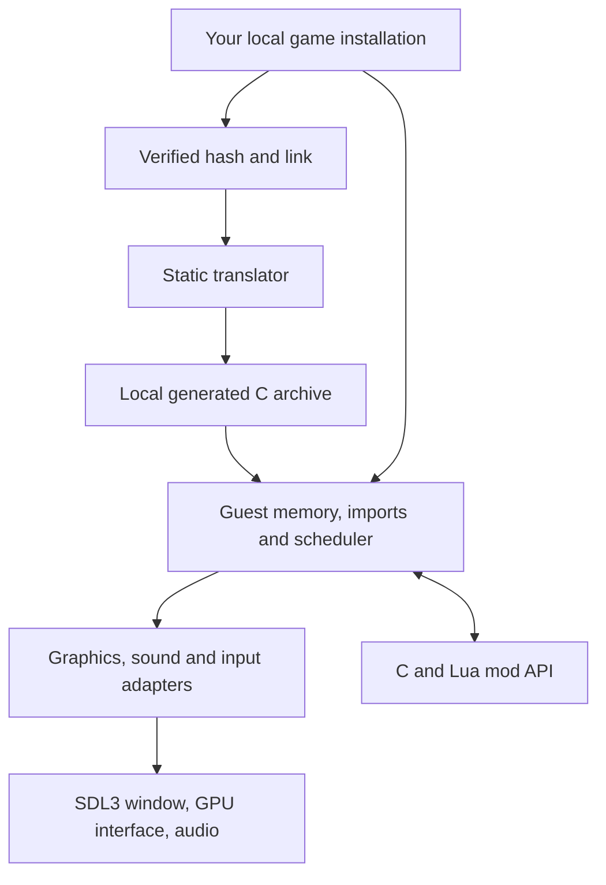

# Architecture

The build translates the supported executable's x86 instructions into C, then
compiles that C alongside a handwritten native runtime. The loader verifies the
executable's hash and maps its original image. Translated code runs natively;
dispatch gaps use the p-code interpreter described below.

## Guest memory and calls

`runtime/memory.cpp` owns the guest address arena and allocator. Guest pointers
remain 32-bit offsets even in a 64-bit process. The platform chooses the arena's
host address through `os_vm_reserve`; translated accessors resolve guest addresses
through `g_mem`. Harnesses allocate their own arena through the same platform API.
Code that runs guest functions against other memory exchanges bytes with
`recomp_arena_swap`. `loader.cpp` maps PE sections,
zero-fills data tails and replaces import-table entries with runtime trampolines.
`imports.cpp` decodes calls and dispatches the original calling conventions.

`runtime/x86.h` defines the register file, flags, x87 state and
instruction helpers used by generated functions. Functions retain stable guest
addresses for dispatch, hooks and diagnostics. Those addresses are identifiers,
not host pointers and not evidence of human-recovered intent.

Dispatch uses `entry_ADDR` thunks and generated direct calls use `call_ADDR` thunks.
Those small, separately compiled thunks supply the current dense table index to one
per-image dispatch function; hook checks, profiling and frame diagnostics no longer
expand at every call. A translated body (`raw_ADDR`) returns without checking the
guest return; `fn_ADDR` adds the check for generic callers, while `call_ADDR` runs the
raw body and leaves the check to the call site, which compares EIP with its
continuation unless the callee's return slot is proved unchanged.
The base-pointer table selects native replacements, while the raw-pointer table
retains translated originals. Direct, tail and computed transfers preserve their
guest stack operations. Replacement headers are compilation dependencies of
`table.c` only, in addition to native sources that explicitly include them.

Integer SSA forwards a register's PUSH value into a matching POP or LEAVE when
every memory path proves the saved slot unchanged. Unknown aliases and opaque
effects block forwarding; a call crosses only when its return stack adjustment
is known, under the x86 stack-discipline premise that a callee does not write
its caller's save slot. Bodies can prove a GPR returns its entry value even
across calls, using the callee contracts known below. This preservation contract
lets callers retain the value in host SSA while still publishing any input the
callee reads. Hooked dispatch retains its CPU reload fallback. The
register-preservation diff suite covers restoration after intermediate EBP
publication, including functions that use EBP as scratch.

Body chunks contain only local callee declarations, with no global function
list or hook indices. They start in fixed 16 KiB guest-address buckets and
split by address until their emitted bodies fit a 2 MiB source budget.
Oversized functions, including their alternate entries, stay intact in separate
files scheduled first by the build. A change can repack its own bucket, but
cannot move functions across the rest of the image. Dense-index changes can
still rebuild lightweight entry shards and the table. Shared inline semantics
in `x86.h` still require recompiling every body that includes that header.

## Threads and ownership

Original game threads are cooperatively scheduled by `runtime/kernel32.cpp`.
Each has a register file and stack, but **one guest thread holds the execution
baton at a time**. A blocking import yields it. Host workers never mutate guest
memory concurrently with that thread.

The presentation worker consumes completed immutable frames. GPU resources and
texture revisions remain alive until commands that reference them complete.
Audio queues use their own clock and synchronization. Window events publish
requests for the guest thread rather than directly executing guest functions.

Guest COM views live in guest memory as a 16-byte header (vtable address,
magic, host object id and interface id); C++ owns COM identity, interface views
and reference counts. The Rust renderer owns API state, resources and layouts
reached through the CXX bridge (`dx/d3d_bridge_helpers.h`). C++ copies scalars
and borrowed slices in for one synchronous call and writes guest results out;
Rust never holds a guest address. D3D7 and D3D8 keep device, resource metadata,
shader records and binding state in Rust.

D3D9 ownership is split by object. The factory's COM identity and references
stay in C++. Each device owns its `GpuContext`, creation and presentation
parameters in Rust; C++ keeps its COM identity, factory reference and focus
window. Rust owns vertex/index buffers, standalone surfaces and 2D/cube/volume
texture descriptors, CPU layouts/bytes, GPU resources, locks, dirty regions,
priority/LOD and byte private data. SYSTEMMEM/SCRATCH storage is CPU-only;
DEFAULT/MANAGED storage has owned wgpu handles and upload/readback paths.
C++ retains resource/device identities and per-subresource guest staging.
Texture level surfaces and volumes share the parent's Rust holder, retain the
parent COM object and cache weak child ids, avoiding a parent/child reference
cycle. Their private data uses separate Rust view namespaces. Synchronous
borrowed slices are copied before return; queued work retains its bytes and
GPU handles. Global COM reset drops holders after guest heap reset and does not
free stale guest allocations. The device owns one implicit swap chain: Rust
creates the windowed back buffer and optional auto-depth target, validates
presentation parameters for create and reset, and presents by handing the
target's texture to the presenter, falling back to an owned CPU RGBA readback;
source and destination rectangles go through a separate presented image. `Present`, `Reset`,
`TestCooperativeLevel` and the presentation caps/`Check*` answers are Rust.
A single shared loss/reset-required token is carried by the device and every
resource's GPU clone, so blocked contexts stop GPU submissions without being
classified as physical loss. `Reset` is a staged transaction: implicit targets
and each live resource's GPU storage are rebuilt from committed CPU bytes off
the live holders, holder pools are checked against the device registration,
readiness is confirmed, and only then are handles installed and the device
moved; the token's reset-required flag clears only after the last holder is
committed. A healthy `Reset` keeps the existing `GpuContext`; physical loss
stages a compatible replacement with an isolated callback token. C++ holds
implicit-surface COM identities as weak device caches, retained device lifetime
via the ref hook, and guest marshalling. Factory adapter enumeration and
`GetDisplayMode` report
the virtual desktop as the current adapter mode and reject adapters or swap
chains other than 0; an implicit surface's `GetType` is answered in C++ as
`D3DRTYPE_SURFACE`, because that classification needs no Rust resource state.
The implicit depth target uses the D3D9 depth-format mapping, not the D3D8 one.
Rust also owns declarations/FVF, shader bytecode, constants, pipeline state and
state-block snapshots/recording. C++ maps opaque handles to COM identities and
retains bound/recorded children internally; externally referenced children and
level views retain the device through ref hooks. FVF declarations have an
internal-only identity cache. Reset preserves shader/declaration objects, rejects
live state blocks and clears pipeline bindings/defaults only at final commit.
Shader translation to WGSL, drawing, fixed-function vertex processing and
event/occlusion queries are Rust; draws are batched per frame and submitted on
a worker thread. Additional swap chains and Windows resource interop are not
implemented.

D3DX buffers own bytes, constant tables own reflection data, and effects and
pools own parameters, preshaders and shared values in Rust. C++ retains the COM
identity and marshals guest calls for every D3D9 and D3DX object, and the
`d3dx9_26` effect entry points create the same Rust-backed objects as
`d3dx9_33`. Unported shader/state/query and D3DX methods fail by name.
`D3DXCompileShader` compiles guest HLSL through pinned vkd3d-shader 2.1 into
guest-owned D3D bytecode buffers; CMake fetches the pinned SPIRV-Headers input.

## A frame through the host

1. The original game submits DirectDraw/Direct3D operations to `dx/`.
2. `host/d3d_render.cpp` translates draws and texture revisions into GPU commands over `host/gpu/gpu.h`.
3. `host/ui_layer.cpp` extracts UI elements from recorded blits.
4. `host/present_thread.cpp` seals the frame, retains its resources and queues it.
5. `graphics/compositor` plans and renders world/UI composition through wgpu; native adapters draw the kit performance and controls overlays.
6. Its shared surface presenter acquires/presents images; completion callbacks retire resources.

`graphics/gpu` owns shared device/queue handles, context generations and physical
loss. `graphics/d3d8-wgpu/src/kit.rs` owns the kit context registry and native
texture-lease handoff. Host GPU execution holds `Arc<SharedContext>` plus an
explicit `QueueOwner` retaining the renderer context, so a presenter that outlives
a guest device still shares that physical context with the next guest device.
Host queue operations flush and synchronize existing D3D9 batches before submitting;
other paths do not create a D3D9 submit worker. The poller retains only the shared
physical context. Imported textures must belong to that same context and satisfy
the sampled/copy-source image contract. SDL supplies window handles; its Metal
views remain owned by the native surface adapter until presenter teardown.
Replaced native GPU backends and
D3D11 rendering are removed. The independent compositor host uses the same Rust
composition and surface APIs without the renderer or guest runtime.

Rust owns the sealed-frame mailbox, submission/retirement queues, per-frame
completion and prefix state, counters and retained repeat snapshot, alongside the
presenter worker and refresh/offscreen scheduling. A single Rust `Presenter` owns
the mailbox and timeline. Its turn driver controls admission, pacing permits,
fallback checks, retries, composition reuse and encoding order, then registers
completion callbacks before present and presents before commit. Native adapters
translate individual GPU operations, draw kit overlays and publish runtime results.
Native frame payloads retain
sealed resources; every lease transferred into Rust is returned to native code
or released once. Retirement waits for every prefix and GPU completion, preserves
submission order and publishes only successful frames. Late callbacks cannot
replace a newer repeat snapshot. Cancellation retains submitted resources until
their work completes.

The native bridge serializes queue operations with the host service mutex;
per-frame snapshots are synchronized in Rust. Readiness and repeat-copy callbacks
inspect owned payloads without guest access or presenter reentry. Layout publication
and guest-resource release run after Rust returns retirement results.

Rust coalesces pending window events and owns swapchain replacement, resize,
acquire/present and teardown through the device adapter. Pending events can be
published by window threads; surface operations run on the presenter thread,
except initial attachment before it starts and teardown after it joins. Backend
callbacks run without the surface controller's mutex held.

Capture readback and delivery run in order on a separate Rust-owned queue, outside
the host mutex and GPU completion thread. Submission backpressure bounds retained
capture images. Each image lease is released after readback, before invoking its
callback, which can query presenter APIs or request shutdown. External shutdown
drains queued captures; capture-initiated shutdown cancels queued deliveries and
releases their image leases without joining its own thread.

The Rust worker retains its native callback context until it exits. It releases
its wake mutex before invoking native callbacks; shutdown joins it without holding
the host service mutex, then drains GPU callbacks and capture deliveries before
releasing resources. Notifications remain valid during that drain. Shutdown
drains queued frames through the same Rust owner; guest-resource release and
layout publication remain native. Turn callbacks are synchronous and borrow their
service context; submitted callbacks retain frame leases until completion.
The native selection adapter holds the host service mutex while calling Rust's
fallback/admission methods and publishing retirements. That round trip keeps
runtime resource release serialized without holding a Rust mutable borrow across
runtime callbacks; it does not duplicate selection policy.

The wgpu host uses refresh-tick pacing and GPU-completion retirement. It has no
drawable display timestamp, so the FPS overlay counts successful GPU completions
and labels their rate CMP instead of DSP. Surface frames retain their owner
through drop and resize.

The wgpu host delivers completion callbacks on a separate worker. Shutdown stops
the presenter and releases its mutex before destroying the GPU device, because
destroying it cancels any remaining callbacks. A callback waiting for GPU work
does not wait for another callback on the same delivery worker.

The Classic profile aspect-fits the selected game resolution. Enhanced can
render the world at drawable resolution with separately scaled UI. Wide view
expands the world only when the drawable is wider than the selected game canvas.
Each game repository documents which rendering profiles its build supports.

## Timing, input and settings

The presentation limit is separate from simulation scheduling. Changing it must
not change the scheduler's guest-time accounting.

`host/input_gate.cpp` maps window coordinates through the published frame layout
and handles edge scrolling and focus. Relative DirectInput counts pass through
unchanged; absolute Win32 positions use the compositor's current guest mapping.
`host/controls/` holds the on-screen controls: a layout model and hit test, a
router that owns each finger, a virtual pad that on-screen and physical
controllers both write to, the overlay that draws it and the on-device editor.
The standalone `--configure` window and the launcher's Configure button offer
Controller setup; it is not part of the in-game F10 page. The controller
setup editor calibrates normalized SDL axes and routes each
physical axis, button and hat direction to guest controls.
Overview shows the connected device, live inputs and starting presets. Controller
output is always available; Mapping separates physical input selection from
explicit output choosers, with input identification. Calibration exposes
centered or one-sided axis response, drift, direction and range controls;
More options sections retain response curves, scale, offset and direction buttons.
Presets and unsaved exits require an explicit choice; Tab/Shift+Tab and Enter
operate the visible controls. Its preview runs before the game starts; Save saves
the profile under `controls/mapper-v1.txt` in the selected game profile.
Calibration includes center and range capture, radial stick and per-axis
deadzones, saturation, response curves and inversion. Output scale and offset
allow pedals to feed separate axes or opposite halves of a combined axis.
The pad is always exposed natively through DirectInput and XInput.
Games that enumerate controllers only at startup need a restart after enabling
joystick exposure. The current SDL host opens the first recognized controller;
calibration is stored per game profile, not separately for each physical device.
DirectInput and XInput still report delivered state to the runtime monitor; the
pre-game editor shows its draft output rather than unavailable guest reads.
Guest-requested DirectInput ranges and formats remain authoritative. The
calibration and mapping model is SDL-free; existing controls and pad suites
exercise the underlying input and API adapters.
The optional `controller_preview` build target renders the editor to a PPM
without starting the game or opening a window. Run it with an output path and
`overview`, `mapping`, `axis`, `advanced`, `calibration`, `response`, `presets`,
`discard` or `disconnected`; optional width, height and DPI scale follow.
See `docs/superpowers/specs/2026-09-17-touch-controls-design.md`.
`mods/display_settings.cpp` validates the host window and performance-overlay
choices. `mods/settings.cpp` atomically persists host and
mod settings in the selected profile; each game's own menu can open the shared
settings page through the mod API.

## Discovery, and code a build does not carry

The Ghidra code map is the authority on where code is, and it can miss some: a
function only ever reached through a pointer nothing resolves, a jump-table
slot no listing owns, a block Ghidra ended early. Each shows up at run time as
a call or jump the address table cannot place.

The translator fills part of the gap itself: a bootstrap sweep of each image
(`bootstrap_map.py`, `discover` in `[translate]`) adds provisional bodies that the
Ghidra map does not name, and a branch into Ghidra-owned code is recorded as an
entry of its owner. Provisional bodies are emitted as decoded regions; a provisional
jump dispatches at run time, with unmapped code handled by the fallback below.
Ghidra stays the authority: the sweep's bodies are evidence, and the fix for any of
them is to create the function or entry in Ghidra, re-export and regenerate.
`recomp-translate --discovery-report OUT.json` writes the discovered code map,
instruction lengths and full discovery report: seed evidence and ranks, gaps, traps,
conflicts, rejected functions and entries, pointer runs and switch tables. It also
includes the original mapped spans, entries and tables for comparison.

The p-code interpreter is the default fallback for missing translated code.
`RECOMP_INTERP=off` disables it at runtime; `pcode` explicitly selects the default.
Unsupported semantics stop with diagnostics, without fabricating a return.
`tools/build.py --no-pcode` omits the runtime SLEIGH library and evaluator;
missing code then fails explicitly. Mobile, web and Windows builds currently
omit this linkage too. A complete static map does not cover heap-generated code,
which still requires the interpreter when used by the guest. When a game supplies
a reloc manifest, heap bodies matching a translated template are bound at run
time by `runtime/reloc.cpp` before the interpreter; each entry revalidates the
guest bytes and import slots, `RECOMP_RELOC=off` restores the interpreter path.
`rk-pcode-ffi` lifts live bytes through the translator's pinned SLEIGH backend;
`runtime/pcode.cpp` evaluates them and `pcode_x86.cpp` maps guest state and dispatch.
Cached lifts are byte-validated, and nested execution retains shared ownership.
The evaluator supports scalar integer p-code; x87/MMX/SSE, other userops, SHRD,
16-bit segmentation and guest divide-exception delivery remain explicit gaps. Memory checks cover the
null page and arena bounds, not page permissions. Scheduler checkpoints run per
instruction; p-code operations and host recursion are bounded, but whole guest
execution has no instruction cap. Unsupported sites inside translated bodies
remain fatal; this fallback only handles dispatch gaps.

`RECOMP_DISCOVERY=<file>` writes `target kind site hits` rows for addresses absent
from the current translation, including calls handled by the interpreter and
taken guest branches retained inside the p-code interpreter. P-code internal
branches and returns are excluded. Targets must lie in a loaded PE executable
section; heap-generated code is excluded. Each target keeps its first kind/site
and a hit count; new targets flush immediately, with final counts written at exit.
A call site is `00000000` unless explicitly supplied by call-site observation;
`c->eip` is not reliable provenance in translated callers. Jump sites inside the
p-code interpreter are exact instruction addresses.
These are execution evidence, not recovered function boundaries or a complete
code map. Naming the file as `discovery_evidence` in `[translate]` seeds the next
sweep; permanent map repairs still go through Ghidra and re-export.

`RECOMP_OBSERVE=<file>` writes one `site target kind count desc` row per indirect
transfer, grouped by how it resolved: `known` (translated function table), `module`
(another module's table), `shim` (Win32 import), `region` (decoded region), `interp`
(interpreted), `thunk`, and `unknown`. It is written at exit, so quit the game
normally to keep it. Developer builds include this support by default;
`tools/build.py --no-observe` compiles it out. Games built through the desktop
app use this option.

## Current boundaries

The original simulation is generated code, not a hand-rewritten gameplay engine.
It intentionally retains low-level register operations. The handwritten runtime,
adapter APIs, build tools and reviewed extension points are the primary places to
contribute. Generated functions have address/symbol comments and per-instruction
provenance; change the translator or a reviewed replacement, then regenerate.

The desktop app builds on macOS, Linux and Windows; the iOS packager runs
on macOS. `src/core/` contains only shared type headers used by the retained
tests; it is not a second game engine. Capture/replay under `mods/native/`
validates prospective native replacements locally.

Platform services (threads, virtual memory, plugins, files, clocks) go through
`platform/os.h`, with POSIX and Win32 implementations; the build is
CMake with presets per platform (`CMakePresets.json`).
